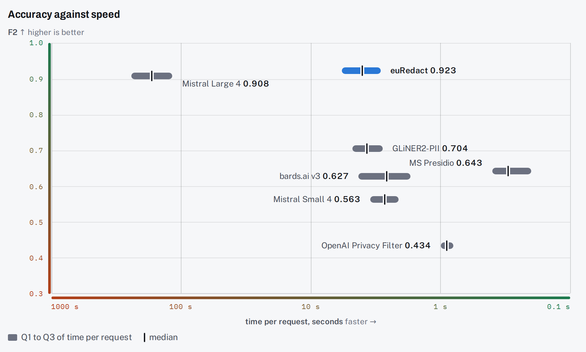
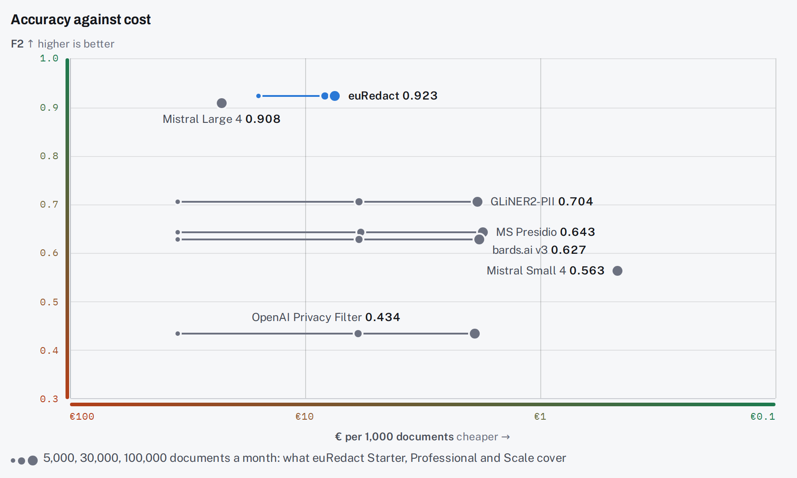

# PII redaction benchmark kit

Rerun euRedact's PII redaction benchmark yourself, on a sample of 90 synthetic documents, with the same
harness, configurations and scorer we used, and compare your numbers with ours.

The documents are a sample of three held-out sets, 30 from each (IT-360, HR-360 and MED-360: IT, HR and medical documents in
English, French, German, Dutch, Polish and Danish, 5 per language per set), drawn by a fixed rule (`manifest/sets.json`).
Every document is synthetic: no real person, no customer data.

**New in this edition:**
- **Danish:** each set has 60 Danish documents besides its 300 in the other five languages. Our full-set figures now
  cover all 360.
- **More documents, none replaced:** 90 in all. The 60 documents of the previous edition are all still here; 30 are
  added, 15 of them Danish.
- **Mistral Large 4** is one of the systems.
- **euRedact:** the SDK is `euredact` 1.1.0, and the model release named below.

## Our scores

F2 (recall weighted twice as much as precision, because a missed item leaks while an extra one only costs
readability), binary, overlap matching, from each set's own `score.py`:

| System | IT-360 sample | HR-360 sample | MED-360 sample | IT-360 full | HR-360 full | MED-360 full |
|---|---|---|---|---|---|---|
| euRedact | 0.933 | 0.952 | 0.887 | 0.936 | 0.945 | 0.899 |
| bards.ai v3 | 0.774 | 0.688 | 0.394 | 0.775 | 0.715 | 0.457 |
| Mistral Small 4 | 0.659 | 0.619 | 0.454 | 0.648 | 0.614 | 0.467 |
| GLiNER2-PII | 0.829 | 0.830 | 0.468 | 0.832 | 0.813 | 0.530 |
| MS Presidio | 0.706 | 0.665 | 0.575 | 0.704 | 0.675 | 0.578 |
| OpenAI Privacy Filter | 0.535 | 0.478 | 0.301 | 0.538 | 0.484 | 0.322 |
| Mistral Large 4 | 0.943 | 0.937 | 0.882 | 0.949 | 0.929 | 0.867 |

euRedact was measured on 2026-11-24 against the production service, with the public SDK `euredact` 1.1.0 and the model release of 2026-11-21.

"Sample" is our run scored on exactly the documents in this kit; "full" is the same run on all 360 documents of the
set. Per-set details, with precision, recall, Art. 9/10 recall and the leak view, are in `results/our_scores.json`.
With 30 documents per set the sample figures move more between sets than the full-set ones; compare a system's sample
score with ours on the same documents.

## Full-set results: all 1,080 documents

The same runs over the three full sets together (IT-360, HR-360 and MED-360), best first. Scored the same way:
binary, overlap matching. **Art. 9/10 recall** covers the special categories of the GDPR (health, religion, sexual
orientation, trade union membership and the like) and criminal records, where a leak costs the most. **Items leaked**
counts gold items that a system's redaction leaves fully or mostly readable (under 75% of their characters covered).

| System | F2 | Precision | Recall | Art. 9/10 recall | Items leaked |
|---|---|---|---|---|---|
| euRedact | **0.923** | 0.856 | 0.941 | 0.830 | 7.6% |
| Mistral Large 4 | **0.908** | 0.946 | 0.899 | 0.701 | 12.2% |
| GLiNER2-PII | **0.704** | 0.800 | 0.684 | 0.042 | 33.5% |
| MS Presidio | **0.643** | 0.777 | 0.616 | 0.378 | 45.7% |
| bards.ai v3 | **0.627** | 0.913 | 0.581 | 0.020 | 44.3% |
| Mistral Small 4 | **0.563** | 0.736 | 0.532 | 0.114 | 48.3% |
| OpenAI Privacy Filter | **0.434** | 0.656 | 0.400 | 0.020 | 60.7% |

Where the leaks are: the share of items leaked in each group of data types, over the same 1,080 documents. Names,
contact details and identifiers are items a single pattern or name can catch; the special categories and criminal
offences are phrases ("was treated for depression", "a conviction for fraud"), which only euRedact and Mistral Large 4
find in any number here.

| Data type group | Items | euRedact | Mistral Large 4 | GLiNER2-PII | MS Presidio | bards.ai v3 | Mistral Small 4 | OpenAI Privacy Filter |
|---|---|---|---|---|---|---|---|---|
| Names | 9,475 | 0.9% | 2.1% | 6.4% | 10.2% | 6.9% | 33.5% | 28.2% ‡ |
| Email and phone | 1,567 | 0.1% | 1.3% | 0.8% | 3.0% | 0.9% | 8.8% | 3.1% |
| Addresses and places | 3,305 | 1.7% | 10.7% | 3.4% | 4.8% | 12.2% | 19.0% | 59.2% ‡ |
| Dates of birth | 388 | 0.5% | 0.5% | 0.0% | 5.9% | 0.3% | 1.0% | 8.5% |
| Government ids | 950 | 0.9% | 8.2% | 25.2% ‡ | 22.9% | 4.4% | 6.4% | 28.6% † |
| Financial | 2,687 | 4.4% | 1.7% | 20.4% | 84.6% ‡ | 62.2% | 37.0% | 87.3% ‡ |
| Network ids and URLs | 1,061 | 0.4% | 3.2% | 36.5% ‡ | 1.4% | 21.3% | 19.3% | 27.0% ‡ |
| Secrets | 186 | 7.0% | 9.1% | 23.7% | 36.6% | 40.3% | 16.1% | 24.2% |
| Other ids | 1,475 | 12.5% | 0.6% | 28.4% ‡ | 35.3% | 17.8% ‡ | 10.1% | 43.3% ‡ |
| Job titles | 3,844 | 3.8% | 3.7% | 17.5% | 95.4% † | 82.5% | 75.3% | 95.4% † |
| Special categories (Art. 9) | 7,787 | 22.0% | 36.9% | 98.0% † | 87.1% | 99.4% | 94.0% | 99.2% † |
| Criminal offences (Art. 10) | 424 | 42.5% | 66.3% | 100.0% † | 93.6% | 100.0% | 99.5% | 99.8% † |
| **All** | 33,149 | **7.6%** | **12.2%** | **33.5%** | **45.7%** | **44.3%** | **48.3%** | **60.7%** |

† the group is not in the system's documented type list; ‡ only some of its types are. Those items still leak in a
real document, so they count here as in every other table. Mistral's models are given every type in their prompt, and
euRedact's guideline is the gold's, so neither is marked.

F2 per language, pooled over the three sets (180 documents per language):

| System | English | French | German | Dutch | Polish | Danish |
|---|---|---|---|---|---|---|
| euRedact | 0.924 | 0.927 | 0.927 | 0.914 | 0.926 | 0.917 |
| Mistral Large 4 | 0.912 | 0.916 | 0.910 | 0.900 | 0.901 | 0.911 |
| GLiNER2-PII | 0.720 | 0.694 | 0.702 | 0.714 | 0.701 | 0.694 |
| MS Presidio | 0.655 | 0.650 | 0.670 | 0.664 | 0.640 | 0.573 |
| bards.ai v3 | 0.661 | 0.635 | 0.630 | 0.632 | 0.602 | 0.601 |
| Mistral Small 4 | 0.564 | 0.557 | 0.563 | 0.552 | 0.569 | 0.576 |
| OpenAI Privacy Filter | 0.460 | 0.478 | 0.487 | 0.451 | 0.388 | 0.326 |

### Accuracy against speed and cost

In both charts the best systems are top right. F2 on the vertical axis; time per request and cost per 1,000
documents on logarithmic horizontal axes (each gridline is ten times the next), slower and dearer to the left.





**Time per request**, from sending a document to receiving its answer, as our harness measured it (Q1, median and Q3
over all 1,080 documents). Totals are left out: they depend on how many requests are sent at once, and on the machine.

| System | Q1 | Median | Q3 | Requests at once | Ran on |
|---|---|---|---|---|---|
| MS Presidio | 0.2 s | 0.3 s | 0.4 s | 1 | local CPU (4 CPUs) |
| OpenAI Privacy Filter | 0.8 s | 0.9 s | 1.0 s | 1 | rented GPU (one L40S) |
| bards.ai v3 | 1.7 s | 2.6 s | 4.3 s | 1 | local CPU (4 CPUs) |
| Mistral Small 4 | 2.1 s | 2.7 s | 3.5 s | 4 | Mistral's API |
| GLiNER2-PII | 2.8 s | 3.7 s | 4.8 s | 1 | local CPU (4 CPUs) |
| euRedact | 2.9 s | 4.0 s | 5.8 s | 4 | euRedact's production cloud, through the SDK |
| Mistral Large 4 | 117.6 s | 170.1 s | 244.3 s | 8 | Mistral's API; reasons before answering (its default effort) |

**Cost per 1,000 documents**, at the monthly volumes euRedact's three plans cover (the tokens each plan includes at
the plans' own estimate of 2,000 tokens per page). Above that, euRedact is an enterprise contract. The managed APIs
cost their usage price, with nothing to host or maintain: euRedact the plan fee, Mistral the tokens our runs used at
its list prices. The self-hosted tools have no licence fee; they pay for a machine only while it works (a 4-vCPU EU
cloud machine at €0.10 an hour, or a GPU at €0.58 an hour), which suits batch work, plus two hours a month of
maintenance and incidents at €87.50 an hour. These are our assumptions, stated so you can change them; the fixed
monthly upkeep is what makes a self-hosted tool dear at low volume and cheap at high volume.

| System | 5,000 a month (Starter) | 30,000 a month (Professional) | 100,000 a month (Scale) | Basis |
|---|---|---|---|---|
| Mistral Small 4 | €0.47 | €0.47 | €0.47 | 1,543 input and 525 output tokens per document at €0.13 and €0.51 per million |
| MS Presidio | €35.0 | €5.84 | €1.76 | self-hosted: €175 a month of upkeep plus the machine while working (0.3 s per document at €0.10 an hour) |
| bards.ai v3 | €35.1 | €5.90 | €1.82 | self-hosted: €175 a month of upkeep plus the machine while working (2.6 s per document at €0.10 an hour) |
| GLiNER2-PII | €35.1 | €5.94 | €1.85 | self-hosted: €175 a month of upkeep plus the machine while working (3.7 s per document at €0.10 an hour) |
| OpenAI Privacy Filter | €35.1 | €5.97 | €1.89 | self-hosted: €175 a month of upkeep plus the GPU while working (0.9 s per document at €0.58 an hour) |
| euRedact | €15.8 | €8.30 | €7.49 | the plan's monthly fee: Starter €79, Professional €249, Scale €749 |
| Mistral Large 4 | €22.7 | €22.7 | €22.7 | 1,503 input and 12,180 output tokens per document at €0.60 and €1.79 per million |

## Rerun it

```bash
cd bench
python -m venv .venv && . .venv/bin/activate
pip install -e ".[test]"                     # the harness and its tests
export BENCH_DATA_DIR="$(cd ../data && pwd)"
pytest -q                                    # offline checks
bench run --system gold --set it360          # sanity check: the gold scores 1.000
```

Then one system at a time, per set (`it360`, `hr360`, `med360`):

| System | Install | Run | Then |
|---|---|---|---|
| euRedact | `pip install -e ".[euredact]"`, `export EUREDACT_API_KEY=...` (a free-tier key covers the sample) | `bench run --system euredact --set it360` | `bench derive --run runs/<that run> --config scoped14` |
| MS Presidio | `pip install -e ".[presidio]"` and the spaCy models `en_core_web_lg fr_core_news_lg de_core_news_lg nl_core_news_lg pl_core_news_lg da_core_news_lg` | `bench run --system presidio --config tuned --set it360` | |
| GLiNER2-PII | `pip install -e ".[encoders]"` (downloads the model on first use) | `bench run --system gliner2 --config v14 --set it360` | `bench derive --run runs/<that run> --config v14_scoped` |
| bards.ai v3 | `pip install -e ".[encoders]"` | `bench run --system bards_v3 --set it360` | `bench derive --run runs/<that run> --config scoped14` |
| Mistral Small 4 | `export MISTRAL_API_KEY=...` (paid, a few cents for the sample) | `bench run --system mistral_small_4 --config v14 --set it360` | |
| Mistral Large 4 | `export MISTRAL_API_KEY=...` (paid: it reasons before answering, about 3 minutes and €0.02–0.03 per document, so roughly €2 for the sample) | `bench run --system mistral_large_4 --config v14 --set it360 --workers 8` | |
| OpenAI Privacy Filter | `pip install -e ".[openai]"`, then the checkpoint at the revision we used: `python -c "from huggingface_hub import snapshot_download; snapshot_download('openai/privacy-filter', revision='7ffa9a043d54d1be65afb281eddf0ffbe629385b', allow_patterns=['original/*'], local_dir='$BENCH_DATA_DIR/models/openai-privacy-filter')"` | `bench run --system openai_pf --set it360` (CPU; slow, about a minute per document) | `bench derive --run runs/<that run> --config scoped14` |

Each run writes a folder under `runs/` with the raw responses, predictions, `score.json` and `meta.json` (versions,
hardware, timing). The local systems (MS Presidio, GLiNER2-PII, bards.ai v3) should reproduce our sample scores
exactly. OpenAI Privacy Filter is the exception: our run used a GPU, and on CPU or another GPU its arithmetic differs
slightly (in our checks a few documents in ten came out differently by a span or two, moving F2 by at most 0.004). The
cloud systems can differ slightly: a service may update its model or its processing; our run dates are in
`results/our_scores.json`.

## How each system is set up

- **euRedact:** the public SDK (`euredact` 1.1.0) in cloud mode, called as a customer calls it; one country per
  document from its language. Nothing switched off (the guideline tags job titles and amounts).
- **MS Presidio:** `presidio-analyzer` with spaCy's large model per language and `config/presidio/tuned.yaml`:
  recognizers for EU identifiers, labelled values, EU phone regions, multilingual context and Art. 9/10 term lists,
  a city list, threshold 0.4. As shipped, Presidio barely handles EU text; this configuration stands in for about a
  week of a team's work, done on other documents than these. Danish gets spaCy's Danish model and the generic
  recognizers but no Danish-specific tuning (the term lists and identifier patterns cover the other five languages),
  so its Danish scores are a floor.
- **GLiNER2-PII:** `fastino/gliner2-privacy-filter-PII-multi`, the model card's 42 labels plus `job_title` and
  `money_amount`, threshold 0.5, 512-token windows; dates other than birth dates switched off.
- **bards.ai v3:** `bardsai/eu-pii-anonimization-multilang-v3`, decoded as its model card's `pii_detector.py` (512-token
  windows, 128 overlap); dates other than birth dates switched off.
- **Mistral Small 4:** `mistral-small-2603` via Mistral's API, temperature 0, structured output, a generic prompt with 34
  types (`prompts/pii_types_v14.md`); the harness finds each quoted value in the text.
- **Mistral Large 4:** `mistral-large-4-0` via Mistral's API with the same prompt, structured output and temperature
  0 as Mistral Small 4, plus top_p 1 (the model requires it with temperature 0). It reasons before answering (about
  12,000 output tokens per document); the harness reads the answer, not the reasoning.
- **OpenAI Privacy Filter:** `openai/privacy-filter` (revision 7ffa9a0) with OpenAI's reference package `opf` (commit
  f7f00ca): Viterbi decoding at the checkpoint's default operating point, whole documents. Its eight types are person,
  address, email, phone, URL, date, account number and secret; the model card describes it as primarily English.
  Nothing switched off.

The scoped rule is the same for every system: a native type is switched off only when the guideline never tags it,
and then only its spans that touch no gold are dropped.

## What the numbers mean

- **F2 / F1 / precision / recall:** binary (was a span redacted at all), overlap matching (one shared character
  counts), from `score.py`.
- **Art. 9/10 recall:** the share of GDPR special-category and criminal-offence spans that were redacted.
- **Leaked:** a gold span with under 75% of its letters and digits redacted (`bench/bench/leaks.py`).
- **Over-redaction:** a redacting span that touches no gold span to redact.

The guideline every set was annotated under is in `data/<set>/guideline.md`.

## Checking the full sets: the manifest

`manifest/<set>.jsonl` lists every document of the three full sets (1,080), with no text: its id, language, genre, the
sha256 of its text, and its gold annotations as offsets, types and a sha256 of each annotated span. `manifest/sets.json`
holds the sha256 of each complete `gold.jsonl` and release archive. Shown any document of a full set, you can check its
text and every annotation against these hashes: the full-set figures above were computed on exactly these documents
and this gold.

## Checking our full-set results

The full-set scores come from our predictions on all 1,080 documents, which this kit does not publish. For each system
and set, `results/our_scores.json` holds a commitment to them (`full_set_predictions`): the sha256 of the predictions
file, its number of lines, the hash of the configuration that produced it, and the sha256 of the gold it was scored
against (the same as in `manifest/sets.json`). Shown a predictions file later, for example as a trusted party under
NDA, anyone can check it against that hash and score it with the set's own `score.py` on the full gold, using this
kit's labels file for the type mapping:

```bash
sha256sum <system>.pred.jsonl     # must equal full_set_predictions.pred_jsonl_sha256
python <full set>/scripts/score.py --tool <tool> --labels bench/config/labels/<set>.json --json out.json \
    <full set>/gold.jsonl <system>.pred.jsonl
```

`<tool>` is the system's `tool` in `bench/config/systems.yaml`. The binary overlap precision and recall in `out.json`
give exactly the full-set F2 above. The commitment is fixed at publication; it cannot be fitted afterwards.

## Licence

[PolyForm Internal Use 1.0.0](LICENSE.md): you may use and change this kit, code and data, for your organisation's
internal purposes, including evaluating PII tools and checking these results. You may not distribute it. This is
source-available, not open source. The models the harness downloads come under their own licences. One adapter
contains code ported from Apache-2.0 sources: see `THIRD_PARTY_NOTICES.md`.
